# ALomancy report: al_loop_0

Workflow `novelty_selection` · trainer `mace` · generator `md` · evaluator `qe` · generated 2026-11-04T01:58:27

**Status:** ✖ 1 error · 💡 1 info · 5 warning(s) logged

## Headline

| | previous | loop 0 | change |
|---|---:|---:|---:|
| Best model test force MAE (eV/Å) | n/a | 0.416 |  |
| Best model test energy MAE (meV/atom) | n/a | 38.4 |  |
| Training structures | n/a | 3.97e+03 |  |
| Test structures | n/a | 410 |  |
| New structures this loop | n/a | 123 |  |
| Warnings / errors logged | n/a | 5 |  |

Best model: fit_0 of 1 (chosen on the `valid` split).

## Issues & suggestions

- ✖ **dft_partial_failure**: 2/10 structures sent to DFT (20%) came back without a result. Check the DFT output in results/<loop>/high_accuracy_evaluation; raise high_accuracy_evaluation.max_time / max_go_time if jobs timed out.
- 💡 **queue_dominated**: high_accuracy_evaluation spent 61% of its time (2.5 h) queued. Raise max_num_of_concurrent_jobs in the HPC profile or use a less busy partition.

## Trends

| loop | test F-MAE (eV/Å) | train | new | DFT returned | GO converged | new redundant | warnings |
|---:|---:|---:|---:|---:|---:|---:|---:|
| 0 | 0.416 | 3970 | 123 | 8/10 | 100% | 0 | 5 |

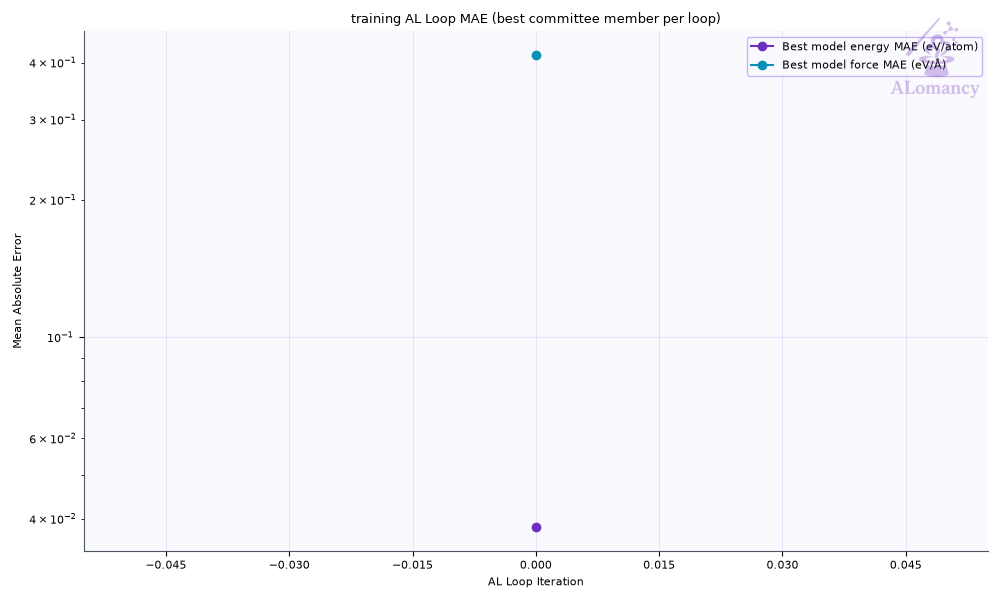

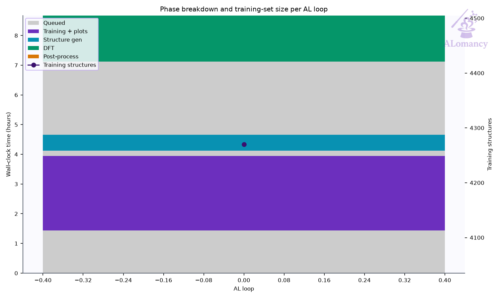

## Best model

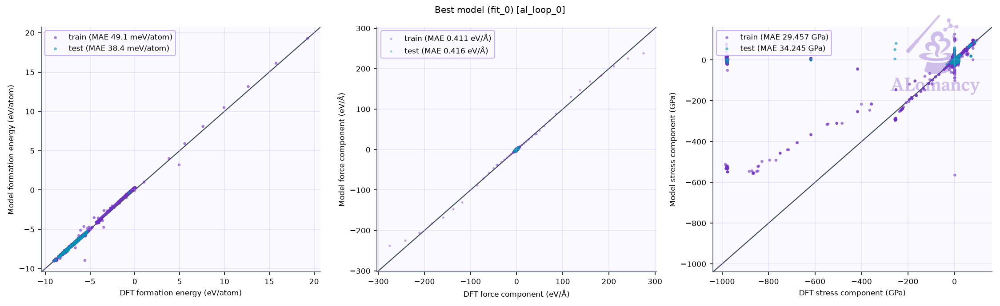

Median relative error: train energy 0.4%, force 43.0%; test energy 0.4%, force 43.5%.
Energies with |formation energy| < 0.05 eV/atom and atoms with |F| < 0.1 eV/Å are left out; force error is |ΔF|/|F| per atom.

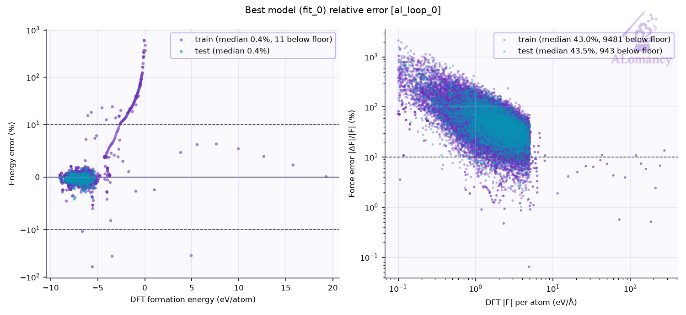

## Training set

| config_type | Train | Test | Excluded: quality filter | total |
|---|---:|---:|---:|---:|
| CNa_dataset | 3538 | 392 | 662 | 4592 |
| IsolatedAtom | 1 | 0 | 0 | 1 |
| high_sd | 100 | 12 | 3 | 115 |
| init_MP | 7 | 1 | 0 | 8 |
| init_amorphous | 26 | 3 | 0 | 29 |
| init_dimer | 99 | 0 | 0 | 99 |
| init_rattle | 5 | 0 | 269 | 274 |
| init_stretch_compress | 120 | 0 | 148 | 268 |
| init_trimer | 50 | 0 | 0 | 50 |
| novelty_selection | 12 | 2 | 2 | 16 |
| on_hull | 1 | 0 | 0 | 1 |
| on_hull_expansion | 11 | 0 | 9 | 20 |
| **all** | **3970** | **410** | **1093** | **5473** |

- Redundancy removal: 0 structure(s) flagged in total, 0 of this loop's 123 new.
- DFT geometry-optimisation starting frames: 8 stored this loop, 6 used (the rest excluded by the train/test filters or redundancy removal).
- Quality filters: high_force: 1084, formation_energy: 21.

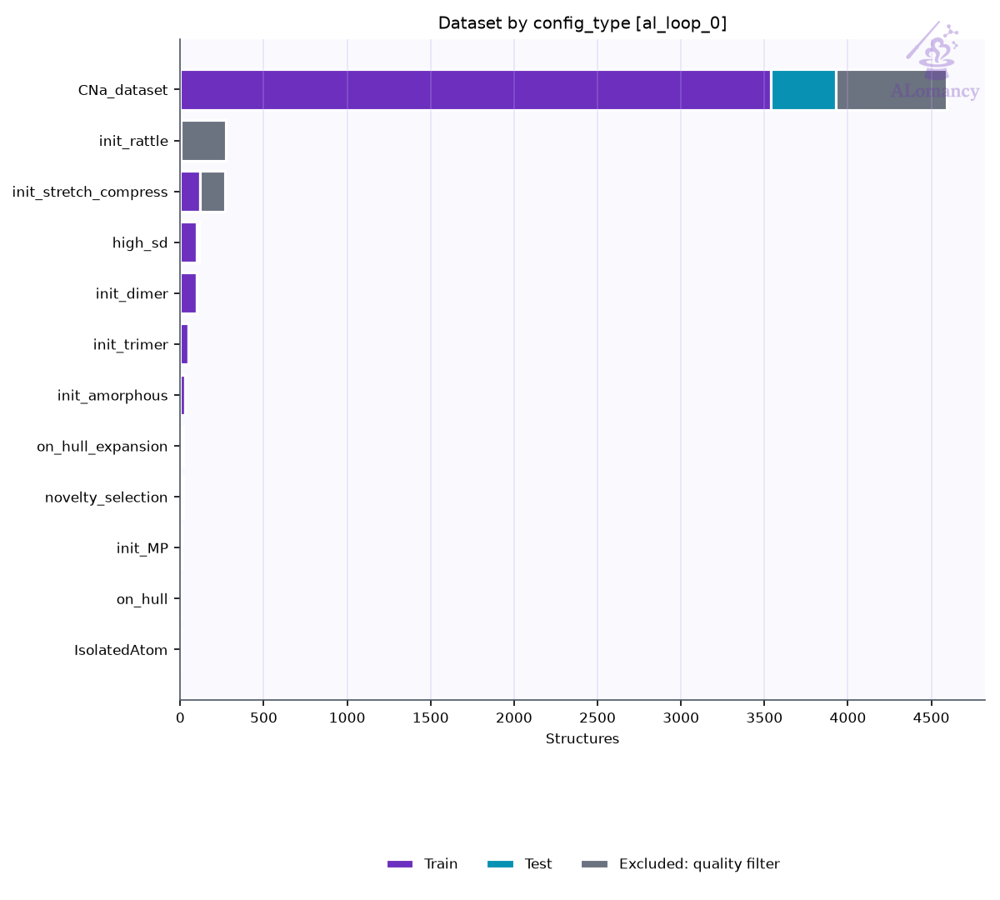

### Redundancy removal

Redundancy removal flags near-duplicate training structures, so the model isn't trained on many copies of the same geometry. Each structure is described by `char_vec_128`: all of its interatomic distances, sorted and resampled to 128 values (`global_descriptor/atomic_distance_descriptor.make_char_vec`). Two structures count as duplicates when the Euclidean distance between their descriptors is below a tolerance: in database order, each structure still in the training set is kept unless it is within the tolerance of one already kept. The plot sweeps that tolerance and counts how many structures are kept at each value. **We are looking for plateaus** (shaded): ranges where the count doesn't change, so the result doesn't depend on the exact tolerance. The orange line (right axis) is the number of structures removed between consecutive tolerance steps, the gradient of the count: zero on a plateau. The start of the lowest plateau at least `general.redundancy_kwargs.min_plateau_width` of the swept range wide is used (dashed line). Nothing is flagged when no plateau qualifies, or when it would flag more than `max_flagged_fraction` of the structures; `general.redundancy_kwargs.tolerance` sets the tolerance directly.

- This loop: 3,583 structures probed; the lowest plateau would flag more than 50% of them, so nothing was flagged.

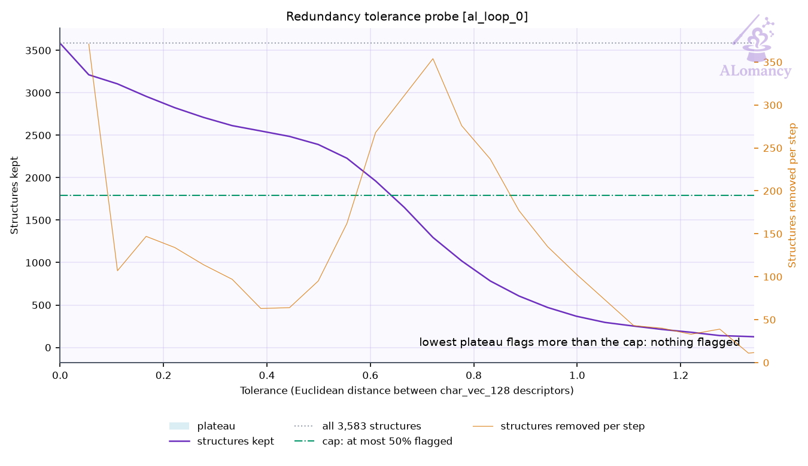

## DFT

- Structures: 8 returned of 10 submitted (8 relaxed, 0 single point).
- Geometry optimisation: 8/8 reached the force ceiling (0.05 eV/Å); steps mean 12.2, median 6, max 39 of 200 allowed.
- Average DFT time per relaxation: 35.4 min (median 28.7, max 86.7; 8 structures).
- Largest per-atom force after DFT: median 0.03, max 0.04 eV/Å.
- DFT phase wall-clock: 4.0 h (mean queue time 148 min).

**Structures evaluated with DFT this loop (final geometries)**

## MLIP training: mace

- Best fit (fit_0) trained for 49 epochs, stage two from epoch 40; weights kept from epoch 49.

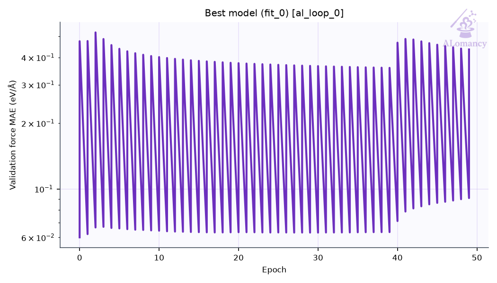

## Structure generation: MD

- Runs: 50 (50 completed, 0 seed(s) replaced)
- Frames: 1000 recorded, 931 physical (no bond < 0.5 Å, volume ≤ 3 x the seed's; 19 frame(s) cut after a run expanded past it, seed frames left out), 100 picked as candidates, spread over each run
- Ensemble npt, T = default K, timestep 0.3 fs

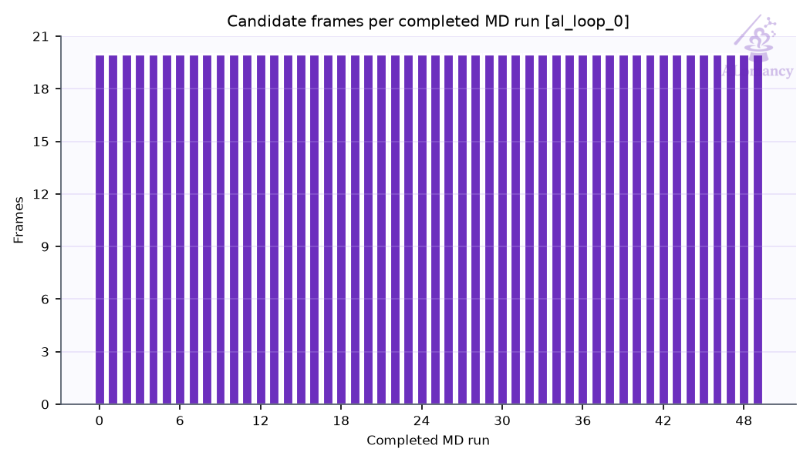

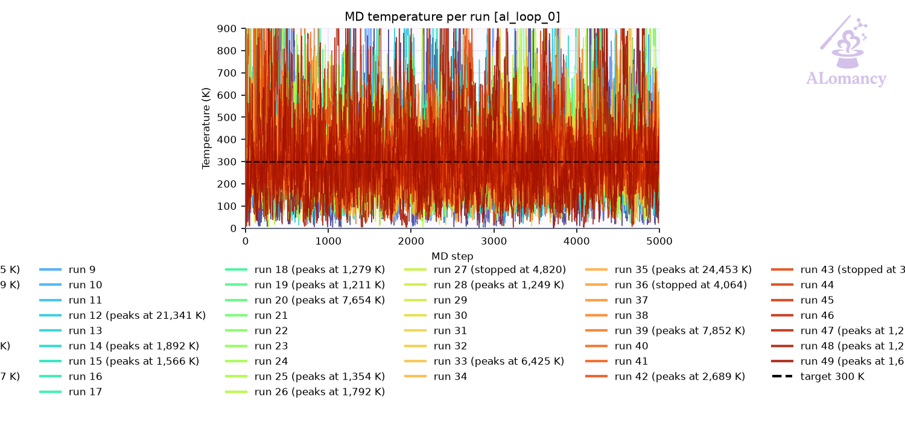

## High-accuracy evaluation: QE

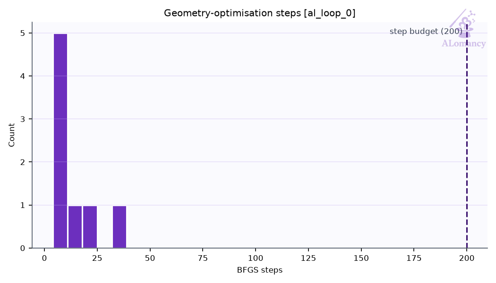

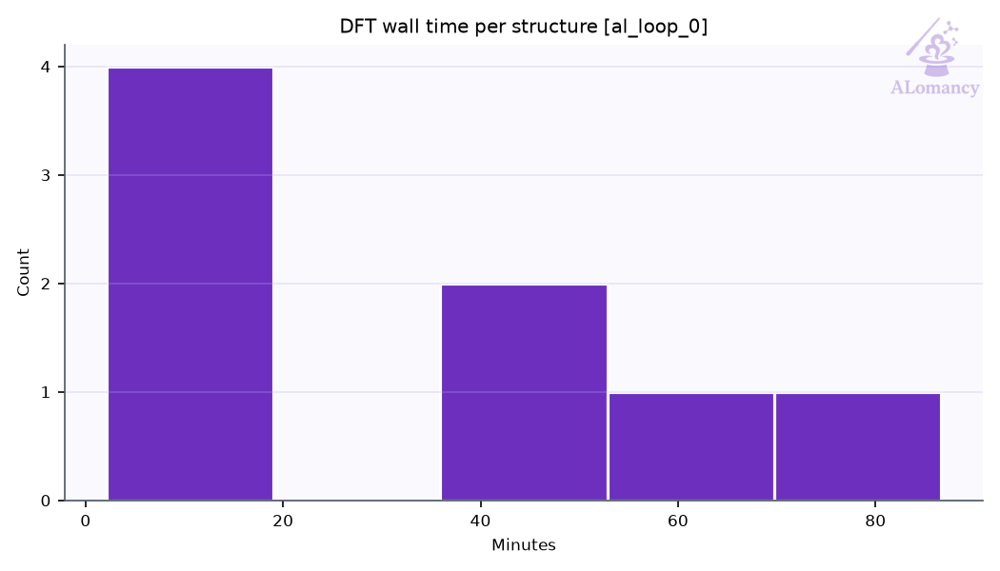

## Selection: novelty

- 10 of 92 candidates selected against 5856 reference structure(s), tolerance 3.06 (descriptor distance).

## Warnings and events

| event | meaning | count |
|---|---|---:|
| `blown_up_excluded` | blown-up cells kept from DFT (volume >> vdW volume) | 1 |
| `dft_summary` | DFT batch summary | 1 |
| `job_failed` | remote job failed | 2 |
| `jobs_started` | remote jobs started | 3 |
| `md_summary` | MD summary | 1 |
| `md_volume_expanded` | MD runs cut after expanding past max_volume_ratio | 1 |
| `novelty_selected` | novelty selection | 1 |
| `quality_filtered` | train/test quality filter passes | 2 |
| `redundancy_cap_hit` | redundancy removal skipped (would flag too many) | 1 |
