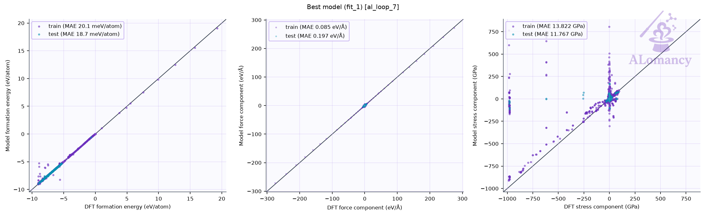
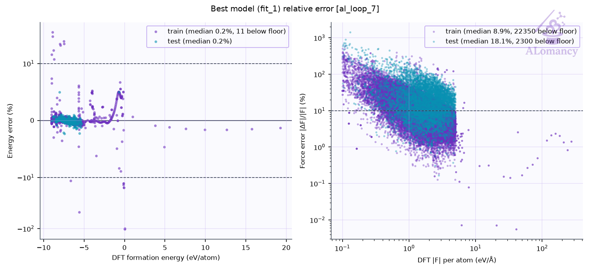

# ALomancy report: al_loop_7

Workflow `committee_uncertainty` · trainer `mace` · generator `md` · evaluator `qe` · generated 2026-11-11T04:26:45

**Status:** ✖ 2 errors · 💡 1 info · 71 warning(s) logged

## Headline

| | loop 6 | loop 7 | change |
|---|---:|---:|---:|
| Best model test force MAE (eV/Å) | 0.196 | 0.197 | +0% |
| Best model test energy MAE (meV/atom) | 18.4 | 18.7 | +2% |
| Training structures | 5.26e+03 | 5.31e+03 | +1% |
| Test structures | 558 | 564 | +1% |
| New structures this loop | 75 | 21 | -72% |
| Warnings / errors logged | 12 | 71 | +492% |

Best model: fit_1 of 3 (chosen on the `valid` split).

## Issues & suggestions

- ✖ **remote_jobs_failed**: 68/156 remote jobs (44%) failed (68) or died (0). Check the job logs (results/alomancy.log has each failure's traceback); jobs killed by the scheduler usually need a longer max_time for that phase, or a partition with more memory.
- ✖ **dft_partial_failure**: 68/100 structures sent to DFT (68%) came back without a result. Check the DFT output in results/<loop>/high_accuracy_evaluation; raise high_accuracy_evaluation.max_time / max_go_time if jobs timed out.
- 💡 **overfitting**: The best model's test force MAE (0.197 eV/Å) is 2.3x its training MAE (0.0849 eV/Å). The test set covers configurations training doesn't: keep adding data, or raise general.dataset_kwargs.valid_fraction to select models on held-out data.

## Trends

| loop | test F-MAE (eV/Å) | train | new | DFT returned | GO converged | new redundant | warnings |
|---:|---:|---:|---:|---:|---:|---:|---:|
| 0 | 0.23 | 3958 | 115 | 100/100 | 100% | 0 | 1 |
| 1 | 0.219 | 4186 | 292 | 96/100 | 99% | 0 | 8 |
| 2 | 0.206 | 4449 | 298 | 99/100 | 98% | 0 | 4 |
| 3 | 0.205 | 4708 | 295 | 98/100 | 100% | 0 | 5 |
| 4 | 0.201 | 4963 | 300 | 100/100 | 99% | 0 | 3 |
| 5 | 0.198 | 5132 | 98 | 100/100 | 100% | 0 | 3 |
| 6 | 0.196 | 5263 | 75 | 92/100 | 100% | 0 | 12 |
| 7 | 0.197 | 5308 | 21 | 32/100 | 100% | 0 | 71 |

## Best model

Median relative error: train energy 0.2%, force 8.9%; test energy 0.2%, force 18.1%.
Energies with |formation energy| < 0.05 eV/atom and atoms with |F| < 0.1 eV/Å are left out; force error is |ΔF|/|F| per atom.

## Training set

| config_type | Train | Test | Excluded: quality filter | total |
|---|---:|---:|---:|---:|
| CNa_dataset | 3538 | 392 | 662 | 4592 |
| IsolatedAtom | 1 | 0 | 0 | 1 |
| high_sd | 1450 | 168 | 130 | 1748 |
| init_MP | 7 | 1 | 0 | 8 |
| init_amorphous | 26 | 3 | 0 | 29 |
| init_dimer | 99 | 0 | 0 | 99 |
| init_rattle | 5 | 0 | 269 | 274 |
| init_stretch_compress | 120 | 0 | 148 | 268 |
| init_trimer | 50 | 0 | 0 | 50 |
| on_hull | 1 | 0 | 0 | 1 |
| on_hull_expansion | 11 | 0 | 9 | 20 |
| **all** | **5308** | **564** | **1218** | **7090** |

- Redundancy removal: 0 structure(s) flagged in total, 0 of this loop's 21 new.
- DFT geometry-optimisation starting frames: 43 stored this loop, 30 used (the rest excluded by the train/test filters or redundancy removal).
- Quality filters: high_force: 1209, formation_energy: 21.

### Redundancy removal

Redundancy removal flags near-duplicate training structures, so the model isn't trained on many copies of the same geometry. Each structure is described by `char_vec_128`: all of its interatomic distances, sorted and resampled to 128 values (`global_descriptor/atomic_distance_descriptor.make_char_vec`). Two structures count as duplicates when the Euclidean distance between their descriptors is below a tolerance: in database order, each structure still in the training set is kept unless it is within the tolerance of one already kept. The plot sweeps that tolerance and counts how many structures are kept at each value. **We are looking for plateaus** (shaded): ranges where the count doesn't change, so the result doesn't depend on the exact tolerance. The orange line (right axis) is the number of structures removed between consecutive tolerance steps, the gradient of the count: zero on a plateau. The start of the lowest plateau at least `general.redundancy_kwargs.min_plateau_width` of the swept range wide is used (dashed line). Nothing is flagged when no plateau qualifies, or when it would flag more than `max_flagged_fraction` of the structures; `general.redundancy_kwargs.tolerance` sets the tolerance directly.

- This loop: 5,021 structures probed; the lowest plateau would flag more than 50% of them, so nothing was flagged.

## DFT

- Structures: 32 returned of 100 submitted (32 relaxed, 0 single point).
- Geometry optimisation: 32/32 reached the force ceiling (0.05 eV/Å); steps mean 6.3, median 5, max 26 of 200 allowed.
- Average DFT time per relaxation: 145.1 min (median 10.7, max 655.4; 32 structures).
- Largest per-atom force after DFT: median 0.02, max 0.04 eV/Å.
- DFT phase wall-clock: 11.1 h (mean queue time 5 min).

**Structures evaluated with DFT this loop (final geometries)**

## MLIP training: mace

- Best fit (fit_1) trained for 299 epochs, stage two from epoch 240; weights kept from epoch 297.

## Structure generation: MD

- Runs: 50 (50 completed, 0 seed(s) replaced)
- Frames: 10000 recorded, 8334 physical (no bond < 0.5 Å, volume ≤ 3 x the seed's; 1616 frame(s) cut after a run expanded past it, seed frames left out), 1000 picked as candidates, spread over each run
- Ensemble npt, T = 500 K, timestep 0.2 fs

## High-accuracy evaluation: QE

## Selection: committee uncertainty

- 985 candidates scored; 100 selected (10 %; max force std dev ≥ 1.83 eV/Å).

## Warnings and events

| event | meaning | count |
|---|---|---:|
| `blown_up_excluded` | blown-up cells kept from DFT (volume >> vdW volume) | 1 |
| `dft_summary` | DFT batch summary | 1 |
| `job_failed` | remote job failed | 68 |
| `jobs_started` | remote jobs started | 4 |
| `md_summary` | MD summary | 1 |
| `md_volume_expanded` | MD runs cut after expanding past max_volume_ratio | 1 |
| `quality_filtered` | train/test quality filter passes | 2 |
| `redundancy_cap_hit` | redundancy removal skipped (would flag too many) | 1 |
