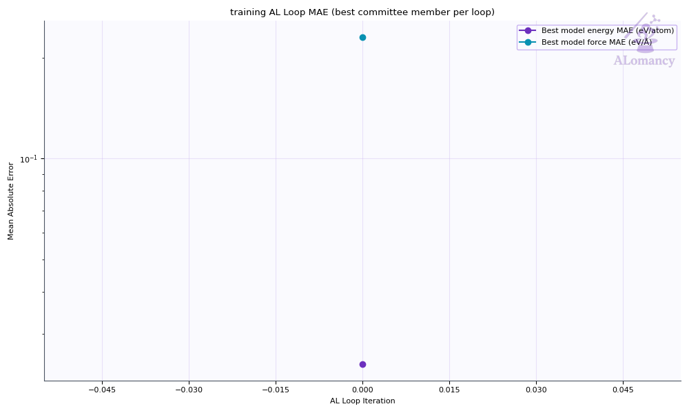
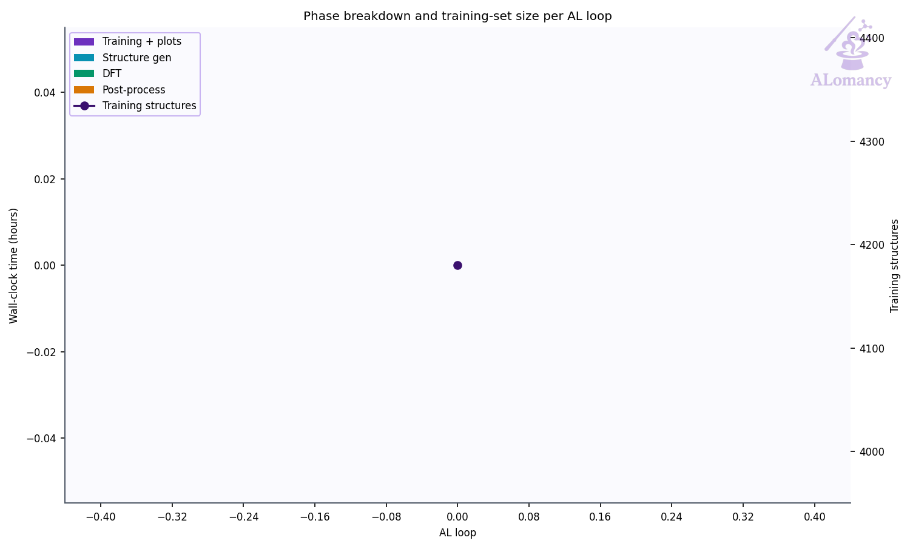
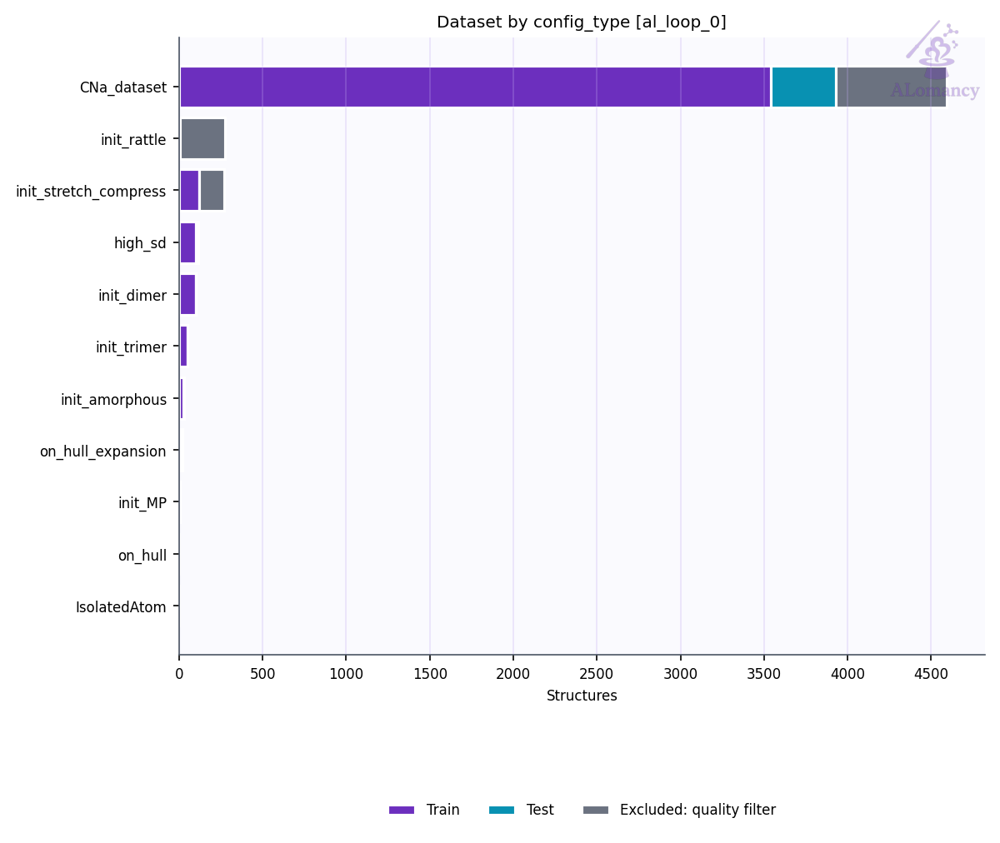
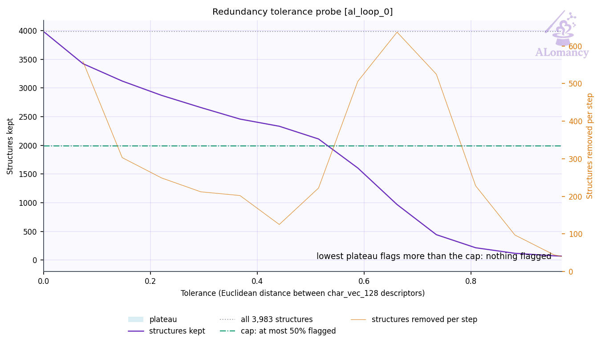
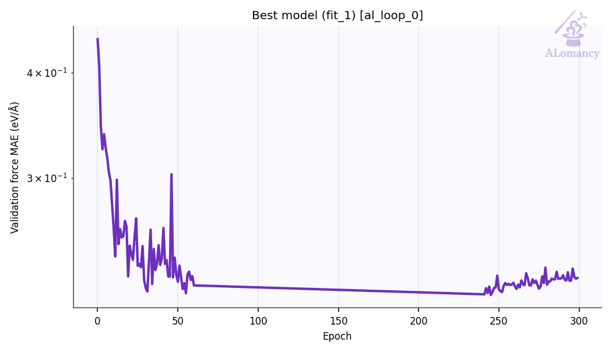
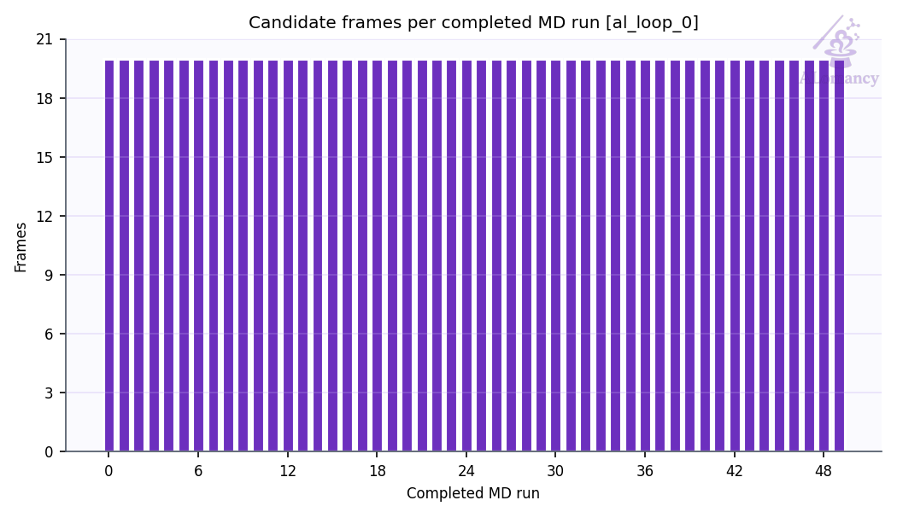
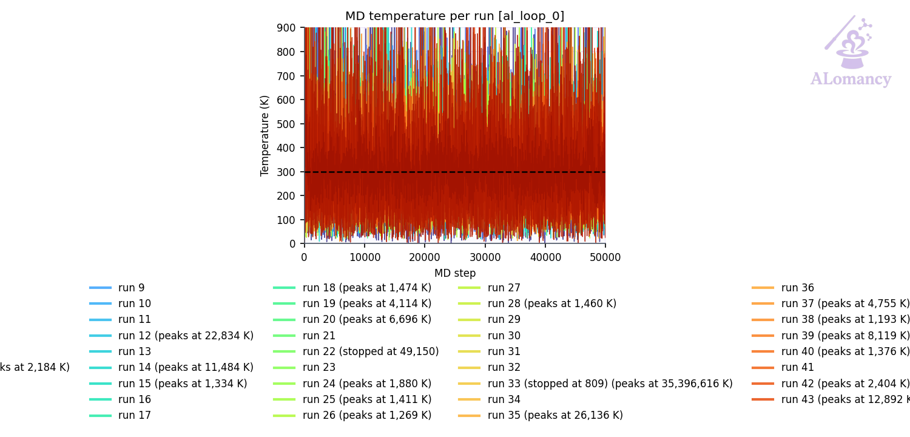
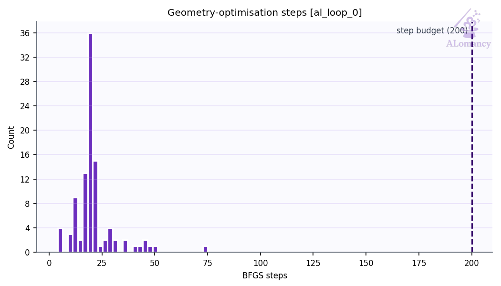
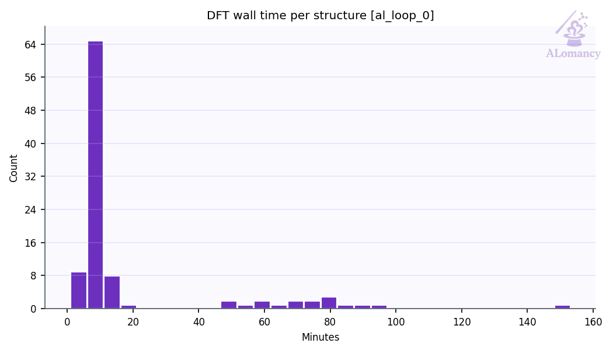
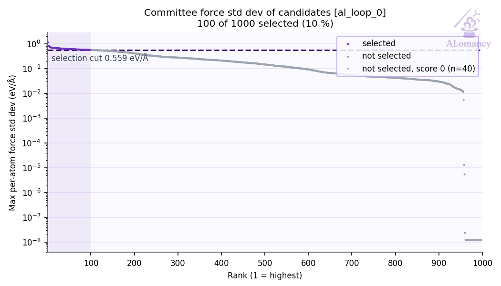

# ALomancy report: al_loop_0

Workflow `committee_uncertainty` · trainer `mace` · generator `md` · evaluator `qe` · generated 2026-11-02T06:38:20

**Status:** 💡 1 info · 1 warning(s) logged

## Headline

| | previous | loop 0 | change |
|---|---:|---:|---:|
| Best model test force MAE (eV/Å) | n/a | 0.23 |  |
| Best model test energy MAE (meV/atom) | n/a | 24.3 |  |
| Training structures | n/a | 3.96e+03 |  |
| Test structures | n/a | 408 |  |
| New structures this loop | n/a | 115 |  |
| Warnings / errors logged | n/a | 1 |  |

Best model: fit_1 of 3 (chosen on the `valid` split).

## Issues & suggestions

- 💡 **overfitting**: The best model's test force MAE (0.23 eV/Å) is 2.4x its training MAE (0.0945 eV/Å). The test set covers configurations training doesn't: keep adding data, or raise general.dataset_kwargs.valid_fraction to select models on held-out data.

## Trends

| loop | test F-MAE (eV/Å) | train | new | DFT returned | GO converged | new redundant | warnings |
|---:|---:|---:|---:|---:|---:|---:|---:|
| 0 | 0.23 | 3958 | 115 | 100/100 | 100% | 0 | 1 |

## Best model

No predictions stored for this loop's best model.

## Training set

| config_type | Train | Test | Excluded: quality filter | total |
|---|---:|---:|---:|---:|
| CNa_dataset | 3538 | 392 | 662 | 4592 |
| IsolatedAtom | 1 | 0 | 0 | 1 |
| high_sd | 100 | 12 | 3 | 115 |
| init_MP | 7 | 1 | 0 | 8 |
| init_amorphous | 26 | 3 | 0 | 29 |
| init_dimer | 99 | 0 | 0 | 99 |
| init_rattle | 5 | 0 | 269 | 274 |
| init_stretch_compress | 120 | 0 | 148 | 268 |
| init_trimer | 50 | 0 | 0 | 50 |
| on_hull | 1 | 0 | 0 | 1 |
| on_hull_expansion | 11 | 0 | 9 | 20 |
| **all** | **3958** | **408** | **1091** | **5457** |

- Redundancy removal: 0 structure(s) flagged in total, 0 of this loop's 115 new.
- Quality filters: high_force: 1082, formation_energy: 21.

### Redundancy removal

Redundancy removal flags near-duplicate training structures, so the model isn't trained on many copies of the same geometry. Each structure is described by `char_vec_128`: all of its interatomic distances, sorted and resampled to 128 values (`global_descriptor/atomic_distance_descriptor.make_char_vec`). Two structures count as duplicates when the Euclidean distance between their descriptors is below a tolerance: in database order, each structure still in the training set is kept unless it is within the tolerance of one already kept. The plot sweeps that tolerance and counts how many structures are kept at each value. **We are looking for plateaus** (shaded): ranges where the count doesn't change, so the result doesn't depend on the exact tolerance. The orange line (right axis) is the number of structures removed between consecutive tolerance steps, the gradient of the count: zero on a plateau. The start of the lowest plateau at least `general.redundancy_kwargs.min_plateau_width` of the swept range wide is used (dashed line). Nothing is flagged when no plateau qualifies, or when it would flag more than `max_flagged_fraction` of the structures; `general.redundancy_kwargs.tolerance` sets the tolerance directly.

- This loop: 3,983 structures probed; the lowest plateau would flag more than 50% of them, so nothing was flagged.

## DFT

- Structures: 100 returned of 100 submitted (100 relaxed, 0 single point).
- Geometry optimisation: 100/100 reached the force ceiling (0.05 eV/Å); steps mean 21.1, median 19, max 75 of 200 allowed.
- Average DFT time per relaxation: 20.7 min (median 10.2, max 153.2; 100 structures).
- Largest per-atom force after DFT: median 0.04, max 0.05 eV/Å.

**Structures added to the dataset this loop (final DFT geometries)**

## MLIP training: mace

- Best fit (fit_1) trained for 299 epochs, stage two from epoch 240; weights kept from epoch 243.

## Structure generation: MD

- Runs: 51 (50 completed, 1 seed(s) replaced)
- Candidate frames: 1000 (per completed run: median 20, min 20)
- Ensemble npt, T = 300 K, timestep 0.3 fs

## High-accuracy evaluation: QE

## Selection: committee uncertainty

- 1000 candidates scored; 100 selected (10 %; max force std dev ≥ 0.559 eV/Å).

## Warnings and events

| event | meaning | count |
|---|---|---:|
| `dft_summary` | DFT batch summary | 1 |
| `jobs_started` | remote jobs started | 5 |
| `md_summary` | MD summary | 1 |
| `quality_filtered` | train/test quality filter passes | 2 |
| `redundancy_cap_hit` | redundancy removal skipped (would flag too many) | 1 |
