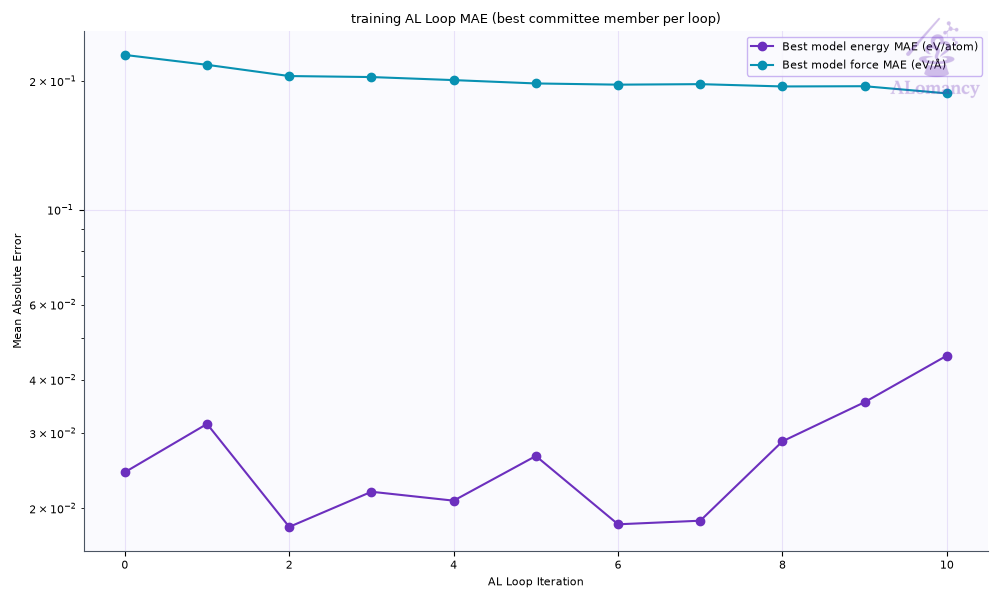
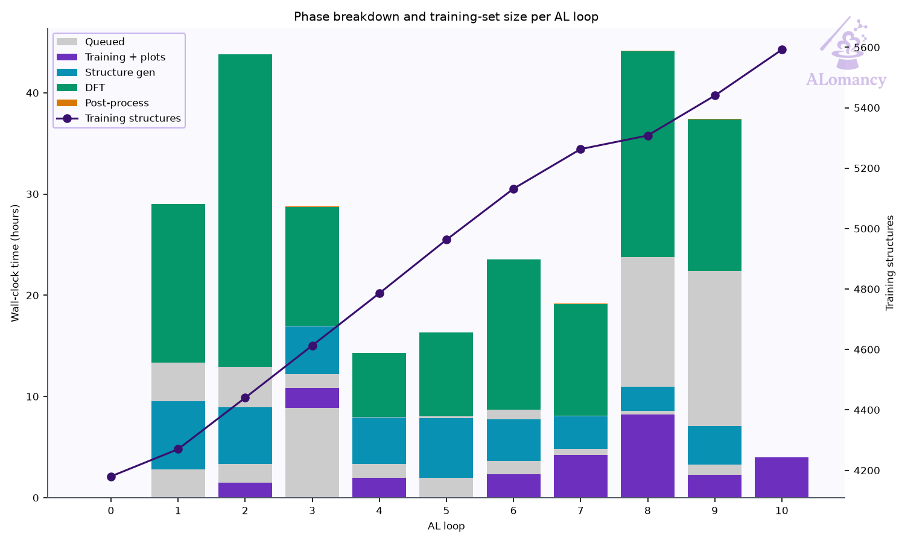
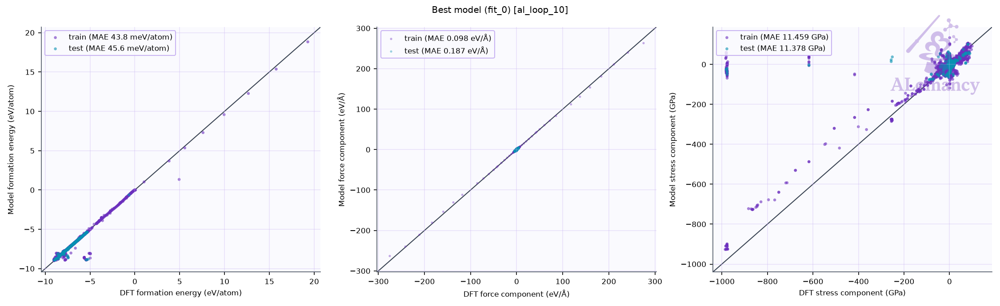
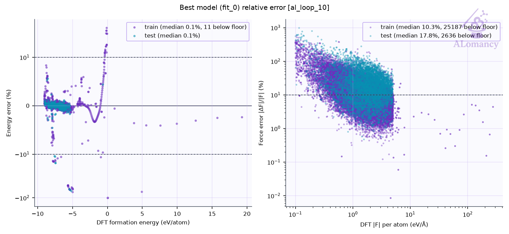
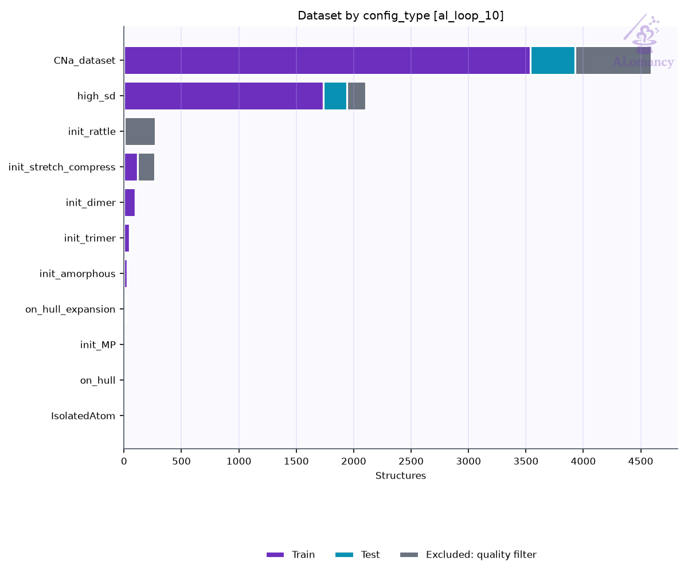
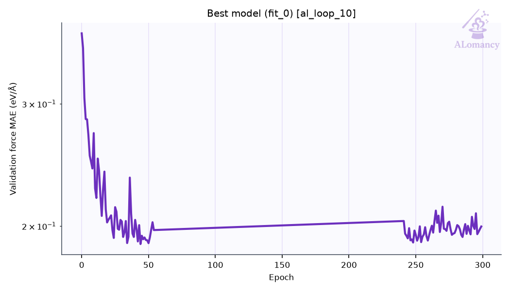

# ALomancy report: al_loop_10

Workflow `committee_uncertainty` · trainer `mace` · generator `md` · evaluator `qe` · generated 2026-11-14T18:03:45

**Status:** ✓ no issues · 0 warning(s) logged

## Headline

| | loop 9 | loop 10 | change |
|---|---:|---:|---:|
| Best model test force MAE (eV/Å) | 0.195 | 0.187 | -4% |
| Best model test energy MAE (meV/atom) | 35.5 | 45.6 | +29% |
| Training structures | 5.59e+03 | 5.59e+03 | +0% |
| Test structures | 601 | 601 | +0% |
| New structures this loop | 40 | 0 | -100% |
| Warnings / errors logged | 12 | 0 | -100% |

Best model: fit_0 of 3 (chosen on the `valid` split).

## Issues & suggestions

No issues detected.

## Trends

| loop | test F-MAE (eV/Å) | train | new | DFT returned | GO converged | new redundant | warnings |
|---:|---:|---:|---:|---:|---:|---:|---:|
| 0 | 0.23 | 3958 | 115 | 100/100 | 100% | 0 | 1 |
| 1 | 0.219 | 4186 | 292 | 96/100 | 99% | 0 | 8 |
| 2 | 0.206 | 4449 | 298 | 99/100 | 98% | 0 | 4 |
| 3 | 0.205 | 4708 | 295 | 98/100 | 100% | 0 | 5 |
| 4 | 0.201 | 4963 | 300 | 100/100 | 99% | 0 | 3 |
| 5 | 0.198 | 5132 | 98 | 100/100 | 100% | 0 | 3 |
| 6 | 0.196 | 5263 | 75 | 92/100 | 100% | 0 | 12 |
| 7 | 0.197 | 5308 | 21 | 32/100 | 100% | 0 | 71 |
| 8 | 0.194 | 5440 | 58 | 86/100 | 99% | 0 | 17 |
| 9 | 0.195 | 5592 | 40 | 92/100 | 96% | 0 | 12 |
| 10 | 0.187 | 5592 | 0 | 0 | n/a | 0 | 0 |

## Best model

Median relative error: train energy 0.1%, force 10.3%; test energy 0.1%, force 17.8%.
Energies with |formation energy| < 0.05 eV/atom and atoms with |F| < 0.1 eV/Å are left out; force error is |ΔF|/|F| per atom.

## Training set

| config_type | Train | Test | Excluded: quality filter | total |
|---|---:|---:|---:|---:|
| CNa_dataset | 3538 | 392 | 662 | 4592 |
| IsolatedAtom | 1 | 0 | 0 | 1 |
| high_sd | 1734 | 205 | 165 | 2104 |
| init_MP | 7 | 1 | 0 | 8 |
| init_amorphous | 26 | 3 | 0 | 29 |
| init_dimer | 99 | 0 | 0 | 99 |
| init_rattle | 5 | 0 | 269 | 274 |
| init_stretch_compress | 120 | 0 | 148 | 268 |
| init_trimer | 50 | 0 | 0 | 50 |
| on_hull | 1 | 0 | 0 | 1 |
| on_hull_expansion | 11 | 0 | 9 | 20 |
| **all** | **5592** | **601** | **1253** | **7446** |

- Redundancy removal: 0 structure(s) flagged in total, 0 of this loop's 0 new.
- Quality filters: high_force: 1244, formation_energy: 21.

## DFT

No DFT this loop.

## MLIP training: mace

- Best fit (fit_0) trained for 299 epochs, stage two from epoch 240; weights kept from epoch 248.

## Warnings and events

| event | meaning | count |
|---|---|---:|
| `jobs_started` | remote jobs started | 1 |
