# ALomancy report: al_loop_2

Workflow `committee_uncertainty` · trainer `mace` · generator `ezga` · evaluator `qe` · generated 2026-11-27T08:09:31

**Status:** 💡 2 infos · 2 warning(s) logged

## Headline

| | loop 1 | loop 2 | change |
|---|---:|---:|---:|
| Best model test force MAE (eV/Å) | 0.0685 | 0.0793 | +16% |
| Best model test energy MAE (meV/atom) | 44.2 | 35.5 | -20% |
| Training structures | 524 | 614 | +17% |
| Test structures | 37 | 47 | +27% |
| New structures this loop | 49 | 50 | +2% |
| Warnings / errors logged | 3 | 2 | -33% |

Best model: fit_2 of 3 (chosen on the `valid` split).

## Issues & suggestions

- 💡 **queue_dominated**: high_accuracy_evaluation spent 99% of its time (94.2 h) queued. Raise max_num_of_concurrent_jobs in the HPC profile or use a less busy partition.
- 💡 **overfitting**: The best model's test force MAE (0.0793 eV/Å) is 2.3x its training MAE (0.0348 eV/Å). The test set covers configurations training doesn't: keep adding data, or raise general.dataset_kwargs.valid_fraction to select models on held-out data.

## Trends

| loop | test F-MAE (eV/Å) | train | new | DFT returned | GO converged | new redundant | warnings |
|---:|---:|---:|---:|---:|---:|---:|---:|
| 0 | 0.0683 | 436 | 47 | 47/50 | 100% | 0 | 5 |
| 1 | 0.0685 | 524 | 49 | 49/50 | 100% | 0 | 3 |
| 2 | 0.0793 | 614 | 50 | 50/50 | 100% | 0 | 2 |

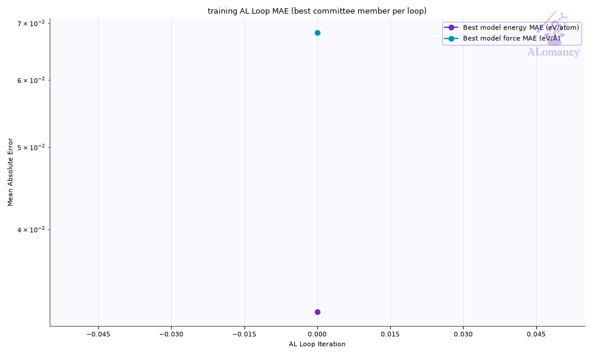

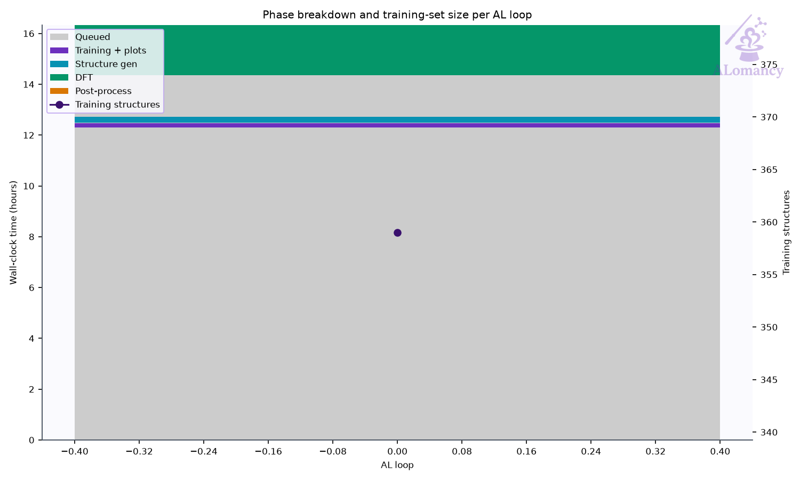

## Best model

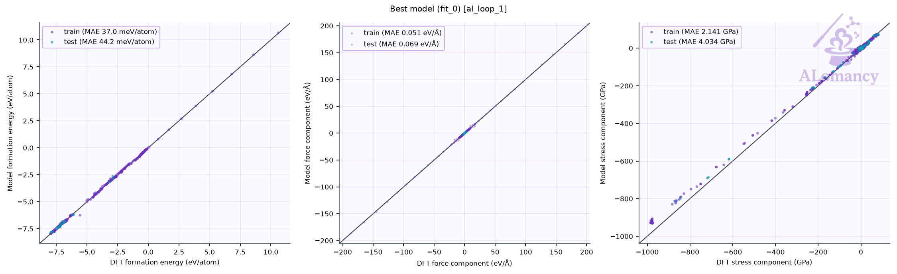

Median relative error: train energy 0.4%, force 5.5%; test energy 0.3%, force 15.5%.
Energies with |formation energy| < 0.05 eV/atom and atoms with |F| < 0.1 eV/Å are left out; force error is |ΔF|/|F| per atom.

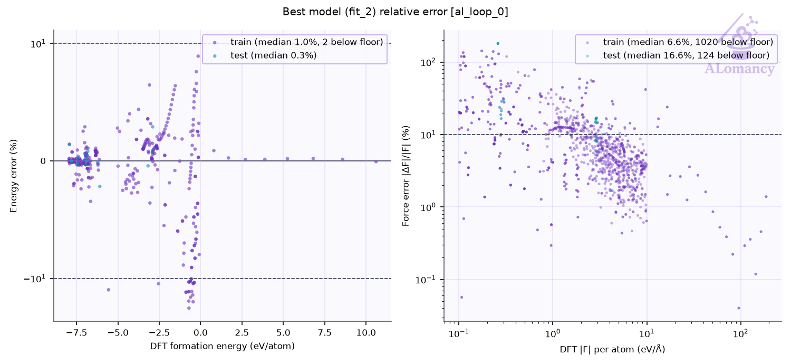

## Training set

| config_type | Train | Test | Excluded: quality filter | total |
|---|---:|---:|---:|---:|
| IsolatedAtom | 1 | 0 | 0 | 1 |
| high_sd | 255 | 29 | 8 | 292 |
| init_MP | 7 | 1 | 0 | 8 |
| init_amorphous | 26 | 3 | 0 | 29 |
| init_dimer | 79 | 0 | 0 | 79 |
| init_rattle | 41 | 1 | 232 | 274 |
| init_stretch_compress | 126 | 13 | 129 | 268 |
| init_trimer | 79 | 0 | 0 | 79 |
| **all** | **614** | **47** | **369** | **1030** |

- Redundancy removal: 0 structure(s) flagged in total, 0 of this loop's 50 new.
- DFT geometry-optimisation starting frames: 50 stored this loop, 50 used (the rest excluded by the train/test filters or redundancy removal).
- Quality filters: high_force: 369, formation_energy: 17.

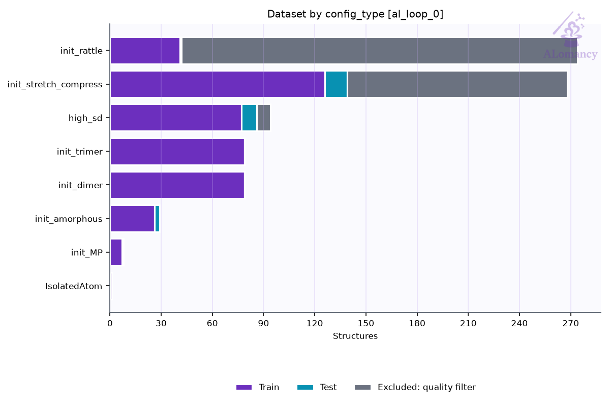

### Redundancy removal

Redundancy removal flags near-duplicate training structures, so the model isn't trained on many copies of the same geometry. Each structure is described by `char_vec_128`: all of its interatomic distances, sorted and resampled to 128 values (`global_descriptor/atomic_distance_descriptor.make_char_vec`). Two structures count as duplicates when the Euclidean distance between their descriptors is below a tolerance: in database order, each structure still in the training set is kept unless it is within the tolerance of one already kept. The plot sweeps that tolerance and counts how many structures are kept at each value. **We are looking for plateaus** (shaded): ranges where the count doesn't change, so the result doesn't depend on the exact tolerance. The orange line (right axis) is the number of structures removed between consecutive tolerance steps, the gradient of the count: zero on a plateau. The start of the lowest plateau at least `general.redundancy_kwargs.min_plateau_width` of the swept range wide is used (dashed line). Nothing is flagged when no plateau qualifies, or when it would flag more than `max_flagged_fraction` of the structures; `general.redundancy_kwargs.tolerance` sets the tolerance directly.

- This loop: 329 structures probed; the lowest plateau would flag more than 50% of them, so nothing was flagged.

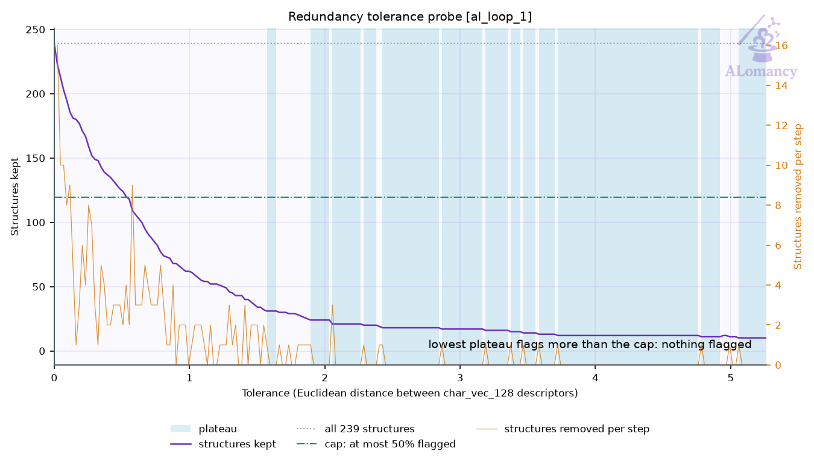

## DFT

- Structures: 50 returned of 50 submitted (50 relaxed, 0 single point).
- Geometry optimisation: 50/50 reached the force ceiling (0.05 eV/Å); steps mean 23.2, median 16, max 157 of 200 allowed.
- Average DFT time per relaxation: 13.6 min (median 8.7, max 75.3; 50 structures).
- Largest per-atom force after DFT: median 0.04, max 0.05 eV/Å.
- DFT phase wall-clock: 95.6 h (mean queue time 5652 min).

**Structures evaluated with DFT this loop (final geometries)**

## MLIP training: mace

- Best fit (fit_2) trained for 299 epochs, stage two from epoch 240; weights kept from epoch 276.

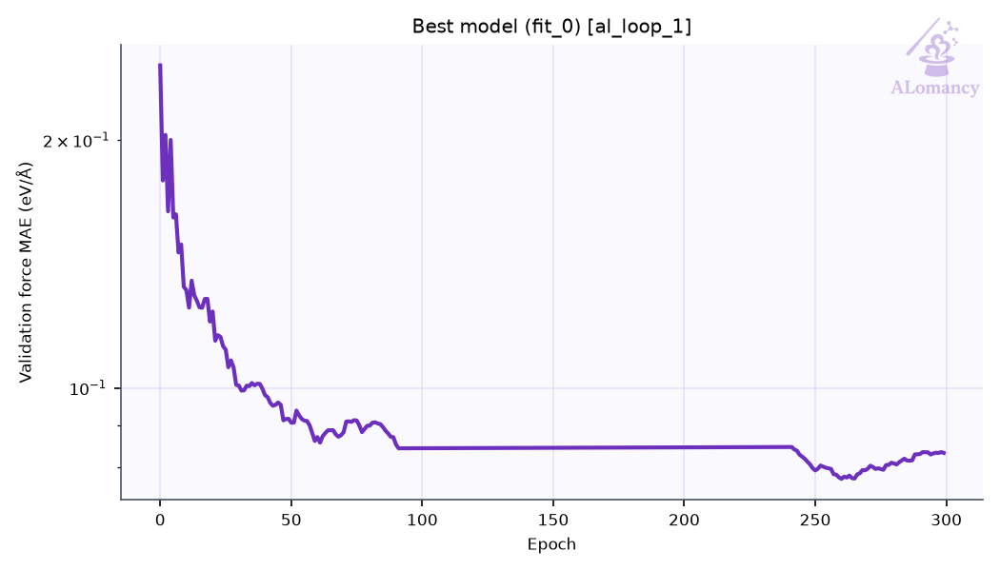

## Structure generation: EZGA

- Seeds: 8, generations run: 11 (max_generations 10, population 100)
- Structures generated: 603, taken as candidates: 500 (newest first, back to generation 5)
- Mutations: mutation_rattle, mutation_random_strain, bounded_mutation_add, bounded_mutation_remove

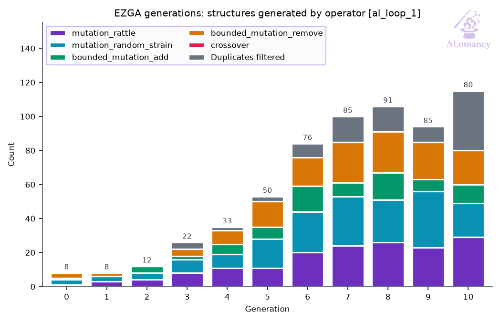

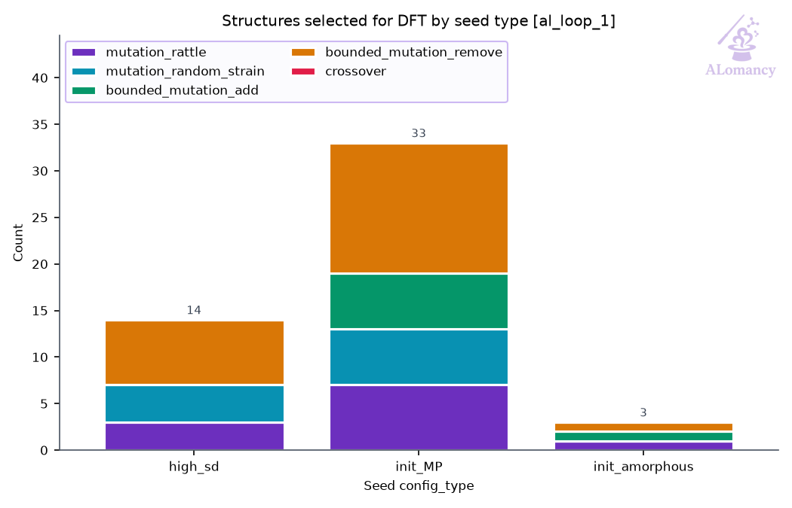

## High-accuracy evaluation: QE

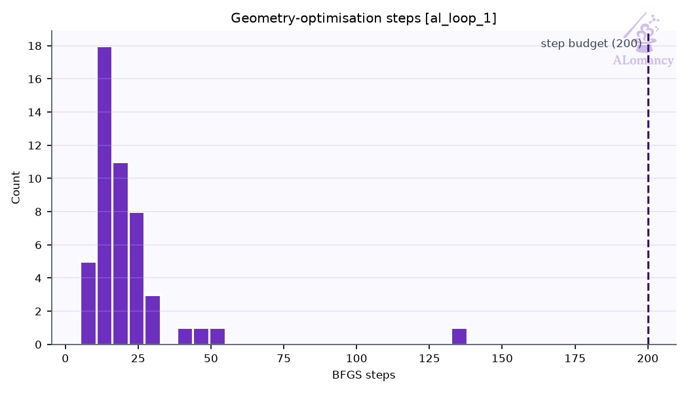

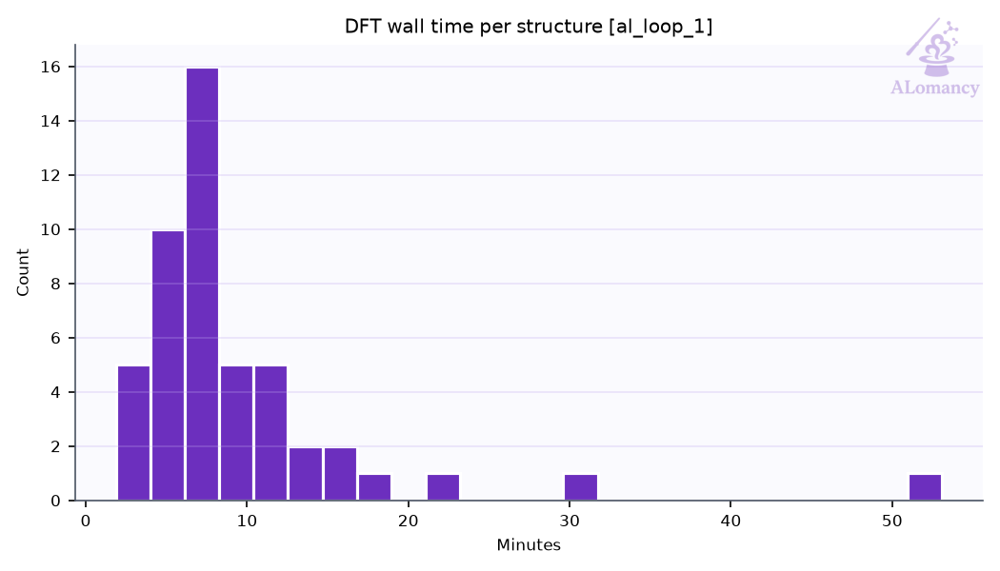

## Selection: committee uncertainty

- 500 candidates scored; 50 selected (10 %; max force std dev ≥ 0.147 eV/Å).

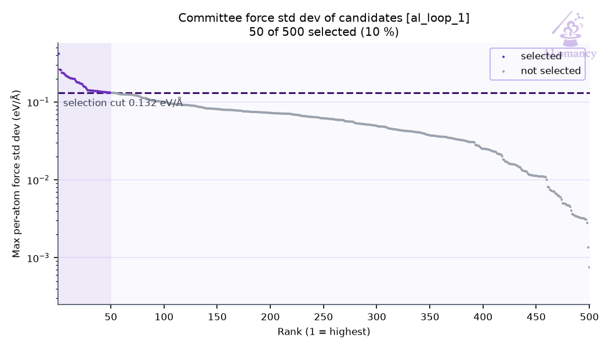

## Warnings and events

| event | meaning | count |
|---|---|---:|
| `dft_summary` | DFT batch summary | 1 |
| `ezga_summary` | EZGA summary | 1 |
| `job_still_queued` | jobs still queued after their time limit (waiting on) | 150 |
| `jobs_started` | remote jobs started | 4 |
| `quality_filtered` | train/test quality filter passes | 2 |
| `redundancy_cap_hit` | redundancy removal skipped (would flag too many) | 1 |
| `stale_sqlite_sidecars_removed` |  | 1 |
