# ALomancy report: al_loop_45

Workflow `committee_uncertainty` · trainer `mace` · generator `md` · evaluator `qe` · generated 2026-10-31T11:51:28

**Status:** ✖ 2 errors · ⚠ 1 warning · 💡 1 info · 100 warning(s) logged

## Headline

| | loop 44 | loop 45 | change |
|---|---:|---:|---:|
| Best model test force MAE (eV/Å) | 0.346 | 0.412 | +19% |
| Best model test energy MAE (meV/atom) | 144 | 156 | +8% |
| Training structures | 2e+03 | 2.01e+03 | +1% |
| Test structures | 100 | 101 | +1% |
| New structures this loop | 40 | 6 | -85% |
| Warnings / errors logged | 33 | 100 | +203% |

Best model: fit_4 of 5 (chosen on the `valid` split).

## Issues & suggestions

- ✖ **remote_jobs_failed**: 97/136 remote jobs (71%) failed (85) or died (12). Check the job logs (results/alomancy.log has each failure's traceback); jobs killed by the scheduler usually need a longer max_time for that phase, or a partition with more memory.
- ✖ **dft_partial_failure**: 94/100 structures sent to DFT (94%) came back without a result. Check the DFT output in results/<loop>/high_accuracy_evaluation; raise high_accuracy_evaluation.max_time / max_go_time if jobs timed out.
- ⚠ **short_bond_excluded**: 2072/3745 structures (55%) were dropped for a bond shorter than 0.5 Å. The model is driving MD into collisions: lower md_kwargs.temperature or md_kwargs.timestep_fs, or add more short-range initialization data (dimers/trimers).
- 💡 **overfitting**: The best model's test force MAE (0.412 eV/Å) is 2.5x its training MAE (0.165 eV/Å). The test set covers configurations training doesn't: keep adding data, or raise general.dataset_kwargs.valid_fraction to select models on held-out data.

## Trends

| loop | test F-MAE (eV/Å) | train | new | DFT returned | GO converged | new redundant | warnings |
|---:|---:|---:|---:|---:|---:|---:|---:|
| 36 | 0.385 | 1860 | 49 | 49/50 | 100% | 3 | 2 |
| 37 | 0.358 | 1894 | 43 | 43/50 | 100% | 2 | 8 |
| 38 | 0.479 | 1929 | 48 | 48/50 | 100% | 4 | 3 |
| 39 | 1.32 | 1972 | 48 | 48/50 | 100% | 0 | 5 |
| 40 | 0.181 | 1698 | 9 | 9/81 | 100% | 3 | 97 |
| 41 | 0.469 | 1896 | 27 | 27/43 | 67% | 2 | 30 |
| 42 | 0.333 | 1926 | 34 | 34/45 | 76% | 0 | 31 |
| 43 | 0.473 | 1971 | 57 | 57/75 | 77% | 3 | 39 |
| 44 | 0.346 | 1997 | 40 | 40/55 | 72% | 5 | 33 |
| 45 | 0.412 | 2007 | 6 | 6/100 | 100% | 0 | 100 |

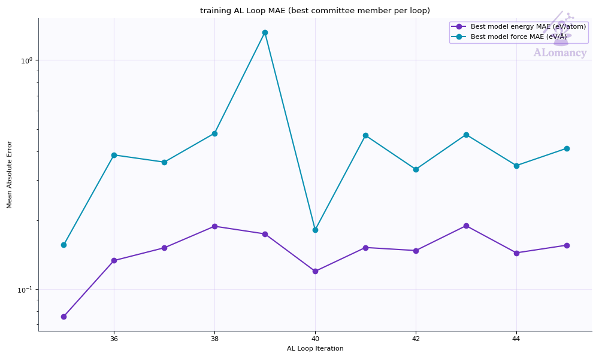

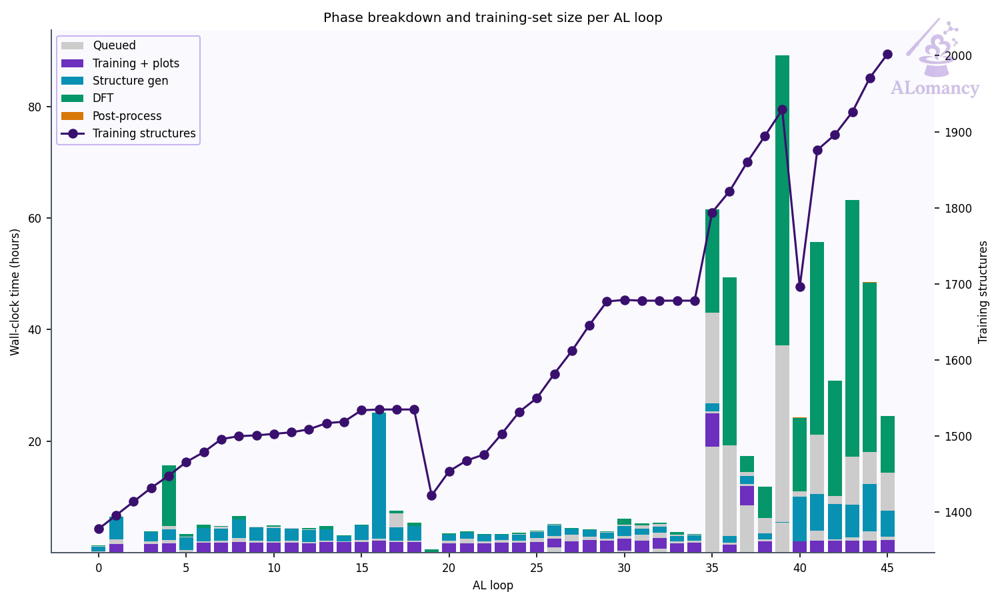

## Best model

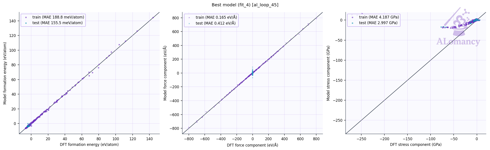

Median relative error: train energy 4.3%, force 18.6%; test energy 1.8%, force 214.7%.
Energies with |formation energy| < 0.05 eV/atom and atoms with |F| < 0.1 eV/Å are left out; force error is |ΔF|/|F| per atom.

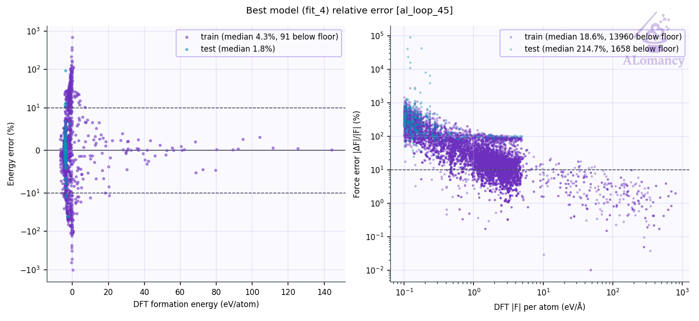

## Training set

| config_type | Train | Test | Excluded: redundant | Excluded: quality filter | total |
|---|---:|---:|---:|---:|---:|
| IsolatedAtom | 5 | 0 | 0 | 0 | 5 |
| high_sd | 606 | 85 | 28 | 375 | 1094 |
| init_MP | 69 | 4 | 0 | 0 | 73 |
| init_amorphous | 67 | 12 | 8 | 0 | 87 |
| init_dimer | 299 | 0 | 0 | 0 | 299 |
| init_stretch_compress | 390 | 0 | 0 | 398 | 788 |
| init_trimer | 571 | 0 | 0 | 0 | 571 |
| **all** | **2007** | **101** | **36** | **773** | **2917** |

- Redundancy removal: 36 structure(s) flagged in total, 0 of this loop's 6 new.
- DFT geometry-optimisation starting frames: 6 stored this loop, 0 used (the rest excluded by the train/test filters or redundancy removal).
- Quality filters: high_force: 771, formation_energy: 181.

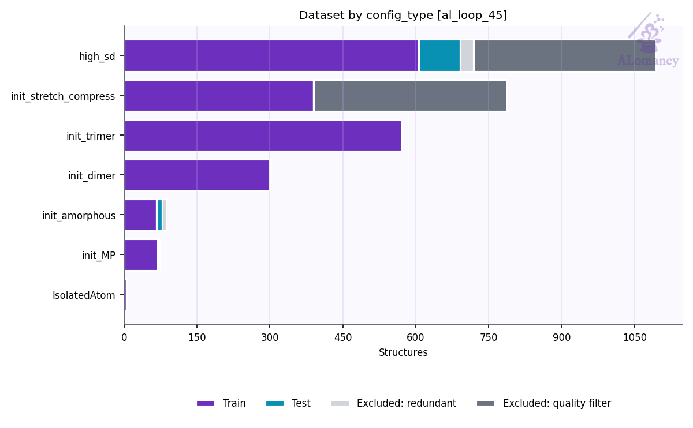

### Redundancy removal

Redundancy removal flags near-duplicate training structures, so the model isn't trained on many copies of the same geometry. Each structure is described by `char_vec_128`: all of its interatomic distances, sorted and resampled to 128 values (`global_descriptor/atomic_distance_descriptor.make_char_vec`). Two structures count as duplicates when the Euclidean distance between their descriptors is below a tolerance: in database order, each structure still in the training set is kept unless it is within the tolerance of one already kept. The plot sweeps that tolerance and counts how many structures are kept at each value. **We are looking for plateaus** (shaded): ranges where the count doesn't change, so the result doesn't depend on the exact tolerance. The orange line (right axis) is the number of structures removed between consecutive tolerance steps, the gradient of the count: zero on a plateau. The start of the lowest plateau at least `general.redundancy_kwargs.min_plateau_width` of the swept range wide is used (dashed line). Nothing is flagged when no plateau qualifies, or when it would flag more than `max_flagged_fraction` of the structures; `general.redundancy_kwargs.tolerance` sets the tolerance directly.

- This loop: 778 structures probed, tolerance 0.0398, 36 flagged as duplicates (8 plateau(s) found).

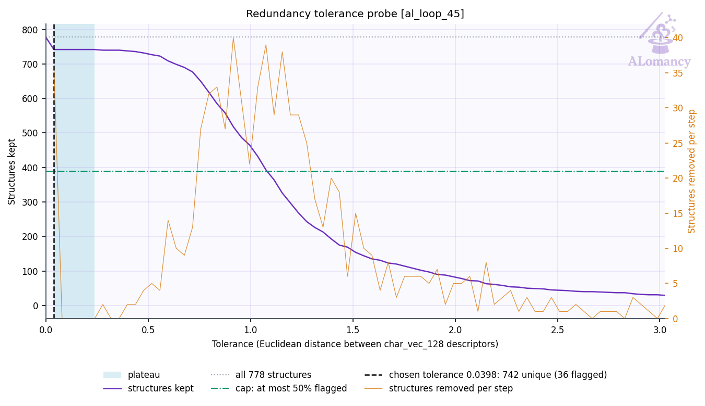

## DFT

- Structures: 6 returned of 100 submitted (6 relaxed, 0 single point).
- Geometry optimisation: 6/6 reached the force ceiling (0.05 eV/Å); steps mean 123.5, median 121, max 177 of 200 allowed.
- Average DFT time per relaxation: 315.1 min (median 245.9, max 557.7; 6 structures).
- Largest per-atom force after DFT: median 0.05, max 0.05 eV/Å.
- DFT phase wall-clock: 17.0 h (mean queue time 413 min).

## MLIP training: mace

- Best fit (fit_4) trained for 199 epochs, stage two from epoch 160; weights kept from epoch 161.

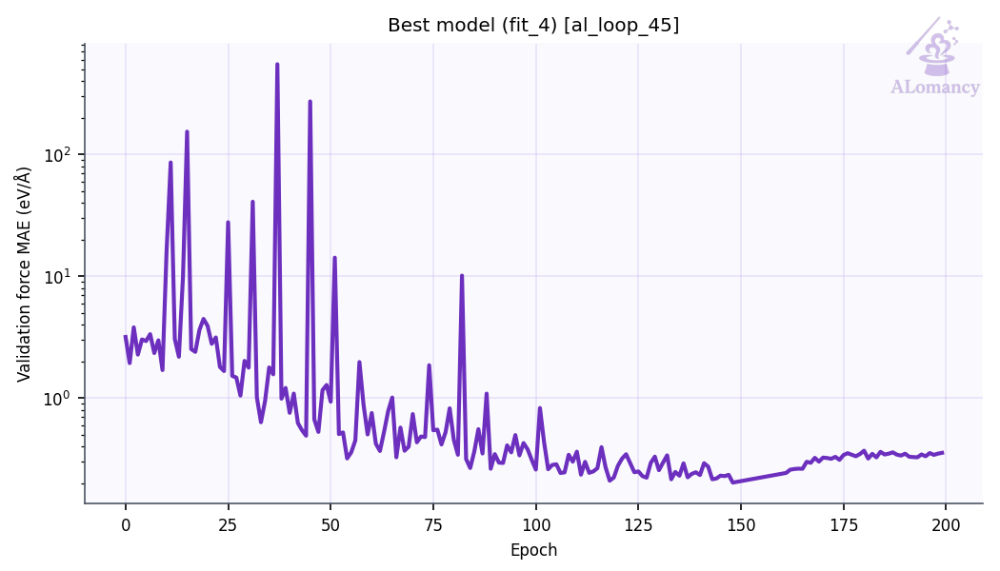

## Structure generation: MD

- Runs: 25 (25 completed, 0 seed(s) replaced)
- Frames: 3270 recorded, 1426 physical (no bond < 0.5 Å, seed frames left out), 500 picked as candidates, spread over each run
- Ensemble npt, T = 300 K, timestep 0.3 fs

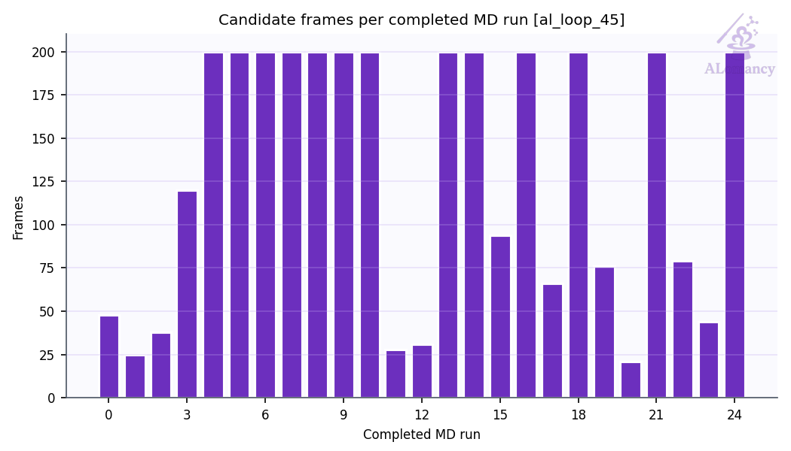

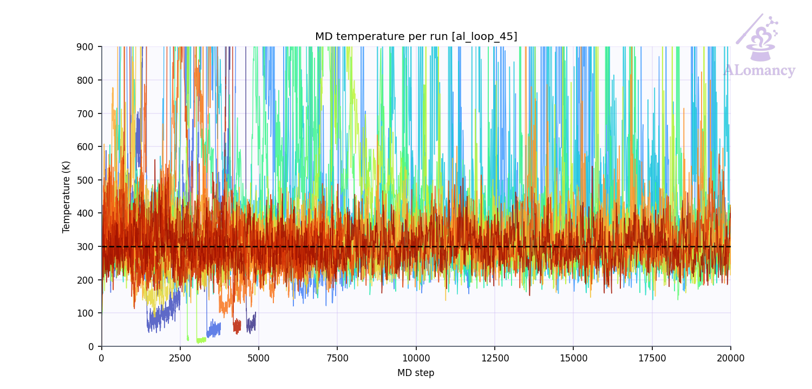

## High-accuracy evaluation: QE

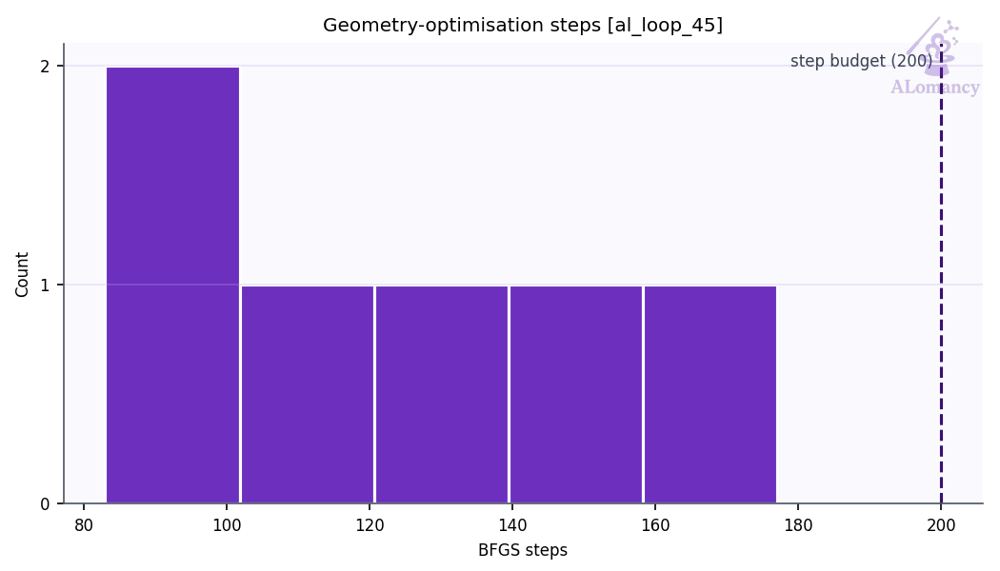

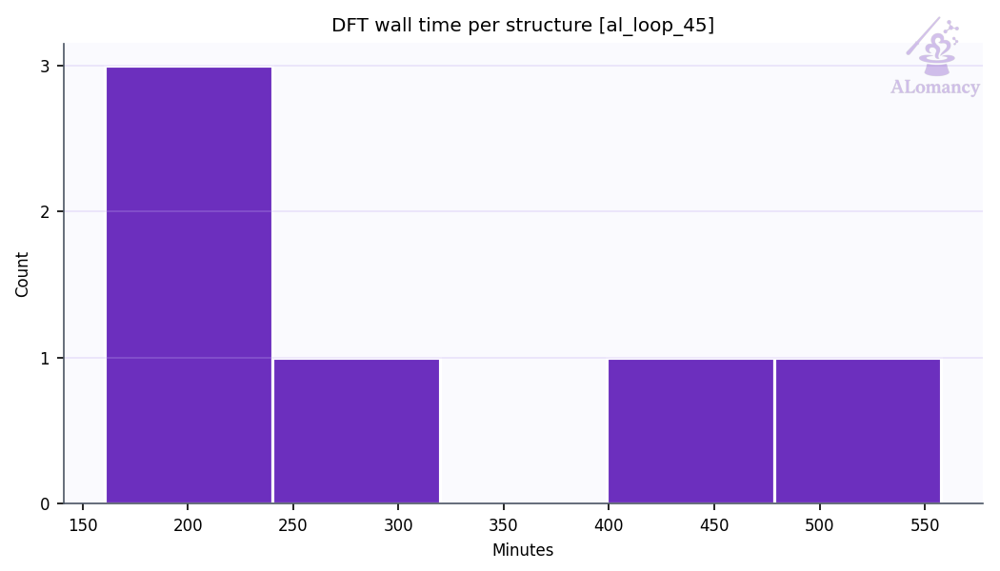

## Selection: committee uncertainty

- 247 candidates scored; 100 selected (40 %; max force std dev ≥ 0 eV/Å).

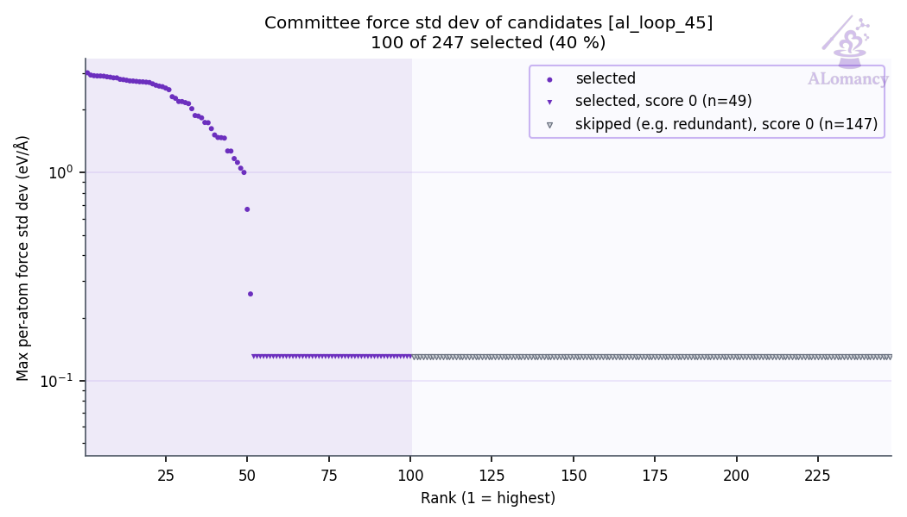

## Warnings and events

| event | meaning | count |
|---|---|---:|
| `dft_summary` | DFT batch summary | 1 |
| `job_died` | remote job died (killed / lost) | 12 |
| `job_failed` | remote job failed | 85 |
| `jobs_started` | remote jobs started | 5 |
| `md_summary` | MD summary | 1 |
| `mlip_relax_dropped` | candidates dropped by MLIP relaxation | 1 |
| `quality_filtered` | train/test quality filter passes | 2 |
| `redundancy_flagged` | redundancy removal passes | 1 |
| `short_bond_excluded` | structures dropped for a short bond | 2 |
